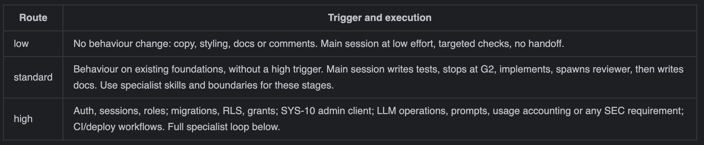
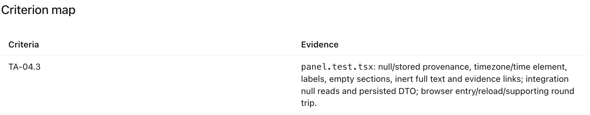
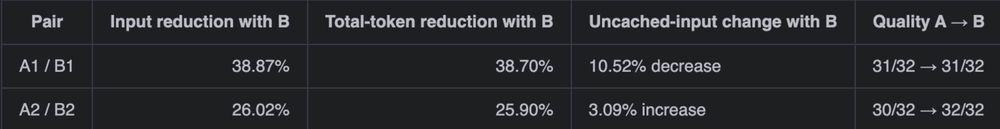

# Reflections: TaiaYovelaPang

[Back to team reflections](../Reflections.md)

<!--
HOW TO USE THIS FILE
- Write in the first person about work you did or watched closely.
- Each section has guiding questions in a comment. Answer the ones that
  apply, replace the PLACEHOLDER line with your prose, then delete the comment.
- Back each claim with evidence: a handoff in workflow/handoffs/, a session log
  in logs/TaiaYovelaPang/, a PR or issue number, or token numbers from
  workflow/scripts/rollout-summary.ts. The brief asks for "concrete examples
  backed by experiments and result analysis".
- Prefer one well-measured example over several vague ones.
-->

## 1. My role and features

I owned the **Teaching Assistant (TA)** role: TA-01 to TA-05 across four
PLAN tasks. All four ran on the high route because they involved protected
learner data, database access controls or an LLM operation.

| Task | What it delivers | PR | Session tokens |
| --- | --- | --- | ---: |
| T-30 | Browse submissions and inspect retained code, answer keys, assessments and grades (TA-01; issue #53) | [#59](https://github.com/CS3227-2610-MP4-LGTM/CS3227-2610-MP4/pull/59) | ≈ 25.05M |
| T-31 | Review flagged submissions, record resolutions and make justified grade overrides (TA-02–03; issue #54) | [#60](https://github.com/CS3227-2610-MP4-LGTM/CS3227-2610-MP4/pull/60) | ≈ 27.49M |
| T-32 | View learners, first-attempt category progress and deterministic challenge recommendations (TA-04.1–04.2, TA-05; issue #55) | [#79](https://github.com/CS3227-2610-MP4-LGTM/CS3227-2610-MP4/pull/79) | ≈ 46.46M |
| T-33 | Generate and retain evidence-linked learner performance summaries (TA-04.3–04.8; issue #56) | [#88](https://github.com/CS3227-2610-MP4-LGTM/CS3227-2610-MP4/pull/88) | ≈ 40.29M |

These approximate figures come from the cumulative main-chat totals recorded
when I wrote session logs [007](../../logs/TaiaYovelaPang/007-ta-submission-inspection-agent-loop.md),
[008](../../logs/TaiaYovelaPang/008-ta-moderation-agent-loop.md),
[009](../../logs/TaiaYovelaPang/009-learner-progress-agent-loop.md) and
[010](../../logs/TaiaYovelaPang/010-ta-performance-summary-agent-loop.md).
They include cached input and validation/recovery work, and are not combined
totals for all specialist agents or the application's LLM usage.

Team-level work included the shared integration contracts
([log 001](../../logs/TaiaYovelaPang/001-shared-role-integration-specification.md)),
the AI security specification
([#25](https://github.com/CS3227-2610-MP4-LGTM/CS3227-2610-MP4/pull/25)),
the TA and Author story specifications
([#42](https://github.com/CS3227-2610-MP4-LGTM/CS3227-2610-MP4/pull/42),
[#47](https://github.com/CS3227-2610-MP4-LGTM/CS3227-2610-MP4/pull/47)),
account pages and role navigation
([#46](https://github.com/CS3227-2610-MP4-LGTM/CS3227-2610-MP4/pull/46)),
and the shared server-only LLM boundary, fake provider, validation and usage
accounting
([#48](https://github.com/CS3227-2610-MP4-LGTM/CS3227-2610-MP4/pull/48)).
I also refined the shared workspace and TA submission interface
([#119](https://github.com/CS3227-2610-MP4-LGTM/CS3227-2610-MP4/pull/119),
[#121](https://github.com/CS3227-2610-MP4-LGTM/CS3227-2610-MP4/pull/121)).

The TA's LLM feature is **learner performance summaries** (`summarize_learner`),
through the shared boundary in `src/server/llm/`. It uses the latest 20
eligible submissions to identify learner blind spots and link observations to
retained evidence. The summary is stored for later inspection, with freshness
tracked as the evidence changes. Category progress and challenge
recommendations are calculated deterministically from first attempts.

## 2. Reflection
In MP4, my main learning was that using multiple agents effectively requires deliberate coordination, context management and resource allocation. In MP3, we focused on establishing a structured development process. However, some of that structure created unnecessary overhead. For LGTM, our code review academy, we refined the workflow to preserve independent checks while making the process more proportionate to each task.

We retained the orchestrator-subagent pattern, where the main agent coordinates specialised roles such as test writing, implementation, correctness review, security review and documentation. This division gave each agent a clear responsibility and made its output easier to assess. We also incorporated a generator-verifier loop, where the implementer produced the changes, and the independent reviewers evaluated them. Blocking findings will then be returned to the implementer for correction.

One limitation of our MP3 workflow was its rigidity. Initially, every stage required a human check and commit, and agents repeatedly ran the full test suite. Even small changes could trigger several stages that contributed little value. Although these checkpoints provided oversight, they also increased waiting time and duplicated work.

For MP4, we introduced three routes based on scope and risk. Low-route tasks, such as documentation or styling changes without behavioural changes, used a lightweight process with targeted checks. Standard tasks involved testing, implementation, independent correctness review and documentation. High-route tasks involving authentication, privileged data access, AI or security received the full specialist workflow. This taught me that the coordination pattern should reflect the consequences of failure, rather than applying the same process to every task.

**The routes we used. Taken from [SKILL.md](../../.agents/skills/sdd-orchestrate/SKILL.md)**

I also learnt that defining a workflow is insufficient unless its execution can be verified. Our orchestrator skill required checks of stage-specific file changes, committed acceptance-test hashes and test results. For example, implementation was checked against the human-approved test baseline so that an agent could not make the tests pass by weakening the expected behaviour. Agents also returned a standard summary containing criterion coverage, checks, findings and decisions needed. These summaries made results easier to compare, but they still needed verification against repository evidence.

Context and shared-resource boundaries were equally important. Each specialist received its assigned role, relevant criteria and permitted reading scope. Only the orchestrator maintained the feature handoff. During independent review, writes were frozen, and repository digests were compared before and after the review batch to detect unintended changes. These mechanisms made responsibilities observable instead of relying only on agents saying that they had followed instructions.

Some waiting was unavoidable because later stages depended on earlier results. Implementation had to wait for approved tests, while documentation depended on reviewed behaviour. On the other hand, correctness and security review did not need to wait for each other as both were read-only and examined different concerns, so we allowed them to run concurrently.

T33, which implemented evidence-linked learner performance summaries, demonstrated the value of specialised reviewers. The correctness reviewer found that the mutation-key scope omitted the learner ID. Consequently, requests for different learners could conflict when the same teaching assistant reused a key. The security reviewer found that final account-check failures were being returned as generic HTTP 403 responses, although an expired session required 401 and a service outage required 503. These findings affected different aspects of the same feature, supporting the decision to retain separate review perspectives.

**Different bugs caught from the reviewers - adapted from [56-learner-performance-summaries.md](../../workflow/handoffs/56-learner-performance-summaries.md)**

The same task also showed why reviewer findings should be evaluated critically. An initial finding suggested that privilege coverage was missing, but it was withdrawn after existing generic catalog tests were inspected. A literal-name search had missed that coverage. My takeaway was that disagreements should be resolved using specifications, code and test evidence, rather than treating either the implementer or reviewer as automatically correct. Genuine requirement conflicts should go back to a human decision instead of being silently resolved through code changes.

**Withdrawn finding. Taken from [56-learner-performance-summaries.md](../../workflow/handoffs/56-learner-performance-summaries.md)**

The confirmed T33 findings were addressed through supplementary regression tests, implementation fixes and independent rereview. The feature needed one fix round. We bounded the workflow at two fix rounds after the initial review so that unresolved problems would receive human attention instead of triggering indefinite retries. This provided a practical stopping rule without allowing agents to dismiss unresolved blocking findings.

Overall, I found the coordination benefits worthwhile for complex or sensitive features. For future projects, I would use multiple agents when independent evaluation provides substantial value, particularly for authentication, data boundaries, AI integration and security. I would use a single agent for small, well-defined changes where coordination would cost more than it contributes. More agents are useful only when their responsibilities are distinct and their outputs justify the additional context and review overhead.

Another major lesson concerned context engineering. In this project, we kept behavioural requirements in story specifications, used PLAN.md to describe work, and connected requirements to tests through stable criterion IDs. This reduced duplication and made the authoritative source easier to identify.

**Example of requirement paired to criterion ID. Taken from [README.md](../../tests/unit/ta/summaries/README.md)**

We applied a similar separation to agent instructions. AGENTS.md contained shared constraints, including commands, security rules and Git boundaries. Agent configurations defined responsibilities, write scopes, models and reasoning effort. Skills described the procedures for particular stages. This kept common guidance relatively compact while allowing specialists to retrieve detailed instructions when needed.

We divided context into three categories. Essential constraints, task scope and role boundaries belonged upfront because missing them could cause incorrect or unsafe work. Detailed specifications, source code and test evidence could be retrieved on demand. Verified progress, decisions, blockers and the next action needed to persist between stages. This helped me move from supplying as much information as possible to supplying information according to its purpose.

My upfront versus on-demand experiment supported this approach. Both conditions analysed T33 implementation readiness with access to the same permitted specification sections. Across two pairs, on-demand retrieval reduced input tokens by approximately 27–39% and total tokens by approximately 26–39%. Quality scores were comparable: both approaches scored 31/32 in one pair, while on-demand retrieval scored 32/32 against 30/32 in the other. These results suggested that reading every permitted section upfront added processing overhead without a consistent quality benefit. However, this measured readiness analysis, so I would not assume the same reduction across implementation tasks.

**Results of the experiment**

Handoffs were another source of context overhead. In this project, we kept handoffs short and simple by having the orchestrator maintain one consolidated handoff per feature. A useful handoff recorded the current checkpoint, relevant criteria, branch and base commit, approved test baseline, completed checks, unresolved findings, decisions and next action. It also distinguished reported results from independently verified evidence. Full transcripts and repeated command outputs were usually unnecessary.

Resource awareness required more than reducing reported total tokens. For this project, we allocated reasoning effort by responsibility: high for planning and security review, medium for test writing, implementation and correctness review, and low for documentation. The specialist configurations used the same model, gpt-6.1-sol, so this was primarily reasoning-effort allocation rather than a comparison of different model sizes.

To monitor usage, we used rollout summaries, per-response exports and session logs. For continuation experiments, measuring only the task’s incremental usage was essential; comparing an existing chat’s entire history against a fresh chat would exaggerate savings. We also separated cached input, uncached input, output and reasoning output, avoiding double-counting breakdowns already included in their parent totals.

The largest recorded totals in my logs came from extended feature workflows involving implementation, review and validation recovery. For example, the learner-progress and performance-summary sessions recorded approximately 46.46 million and 40.29 million total tokens respectively, mostly cached input. These totals suggest that long-running feature sessions deserve particular attention, but they do not provide a reliable ranking of individual specialist stages because stage-level figures were unavailable. Targeted checks, bounded fix rounds, narrower reads and consolidated handoffs addressed likely sources of repetition; only the context experiments quantified their effects directly.

The lesson I would carry forward is to make coordination and context proportionate to the task. Independent agents helped identify meaningful defects, but their value depended on clear ownership, evidence-based review and reliable handoffs. The experiments also made me more careful about measurement: reduced elapsed time, reduced total tokens, improved cache reuse and preserved quality are different outcomes, and each needs its own evidence.

